# LiveBoard Studio

LiveBoard Studio is a full-stack application for designing, managing, and publishing digital signage. An administrator edits a private draft, publishes it explicitly, and public screens render that published snapshot. After the publish is stored, Socket.IO notifies connected displays, and each display loads the snapshot from the API.

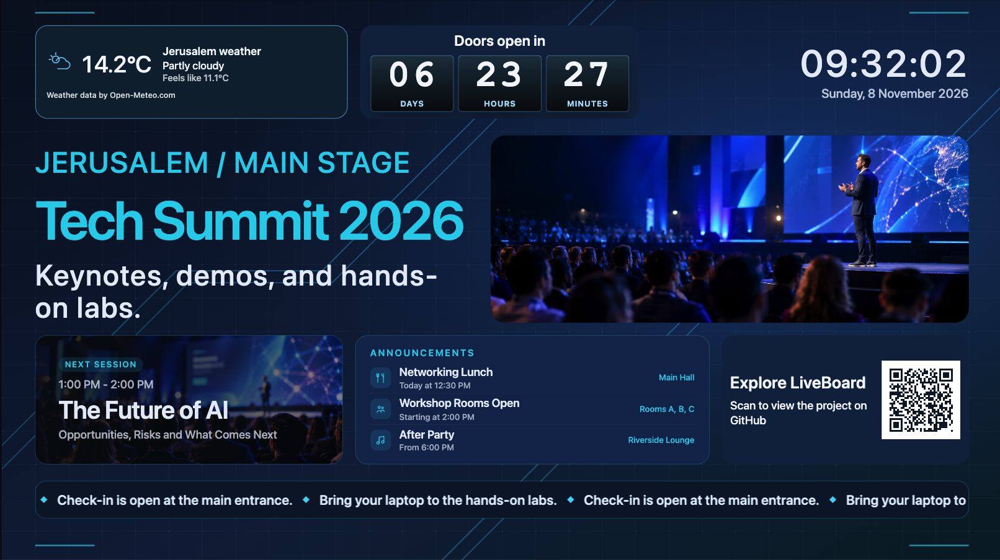

*Tech Summit Showcase running in LiveBoard Studio. [Create this demo board](#optional-tech-summit-showcase) after installation.*

## Features

- Edit landscape (1920 × 1080) or portrait (1080 × 1920) boards and place widgets by dragging and resizing them.
- Add text, clocks, images, information cards, announcements, tickers, weather, countdowns, QR codes, sample headlines, and live USGS earthquake data.
- Rename, reorder, show, hide, and lock layers. Undo and redo cover the current editing session, up to 50 steps.
- Save the draft without changing what screens show. Publish copies the stored draft into the public snapshot.
- Preview the current draft in Studio with the same renderer used by public displays.
- Create a blank board or start from one of five built-in templates. Rename or duplicate an existing board from the board list.
- Register displays, assign a published board, and see which screens are currently connected.
- Upload JPEG, PNG, and WebP images, then search and sort them in the media library.
- Open a board at `/display/:boardId`, or open an assigned screen at `/screens/:displayId`. Neither route requires a session.

## Use cases

### Conference program

A welcome screen can combine a clock, weather, a countdown, session details, a QR code, and a ticker. The Tech Summit Showcase above demonstrates this layout. Publishing the board updates the connected displays that show it.

### Corporate lobby

A lobby screen can present the company name, the date, and a short list of notices without a separate content system.

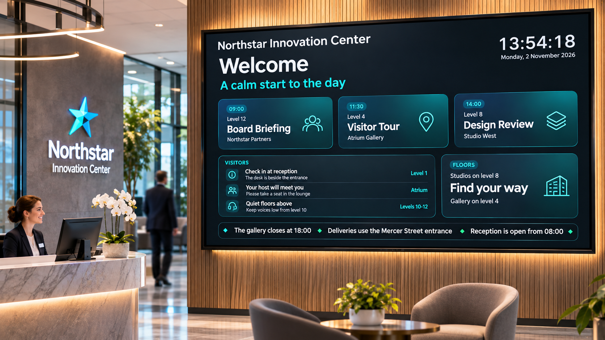

### Meeting room

A room screen can show the current reservation, the next booking, and a short visitor note. The clock and schedule are widgets on the board, not a connection to an external calendar.

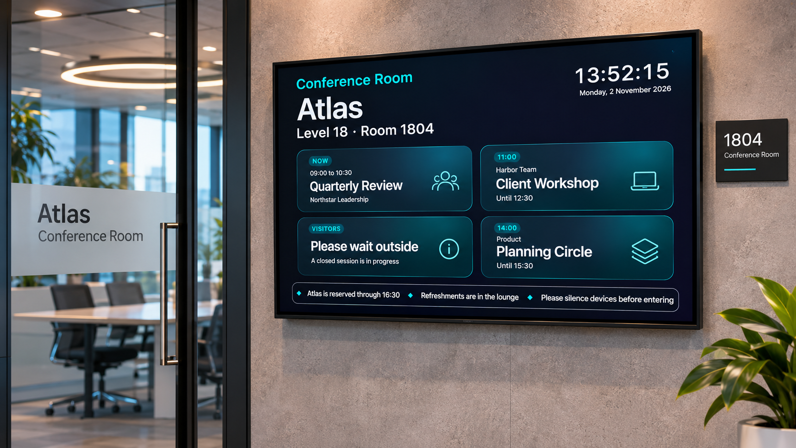

## Studio

Studio is the board editor at `/studio/:boardId`. The canvas, component list, layers, and properties stay in one workspace. Changes stay in the draft until the administrator saves and then publishes.

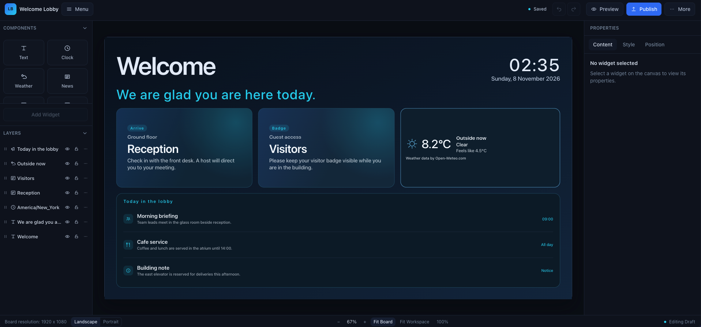

*Welcome Lobby in Studio, created from a built-in template.*

The properties panel edits the selected widget. The layers panel changes stacking order, visibility, lock state, and the layer name. Preview shows the board open in Studio, including edits that have not been saved yet, using the shared board renderer. Publish stays unavailable until the draft is saved. The publish request sends no canvas. The API copies the draft already stored in PostgreSQL.

## Boards and displays

`/boards` lists every board with its name, widget count, and published or unpublished status. From here an administrator can create a board, rename it, or duplicate it.

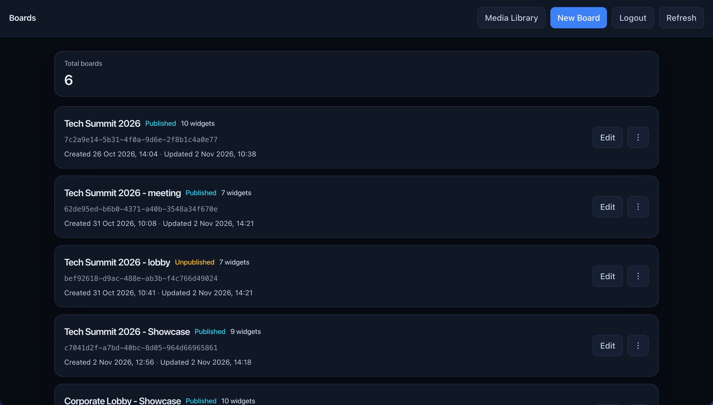

**New Board** offers a blank board in either orientation and five editable templates:

| Orientation | Templates |
| --- | --- |
| Landscape | Welcome Lobby, Conference & Events, Office Dashboard |
| Portrait | Portrait Welcome, Event Schedule |

A template sets the board orientation and creates an unpublished draft with its own widgets. The templates are available on a fresh installation without running the optional seed.

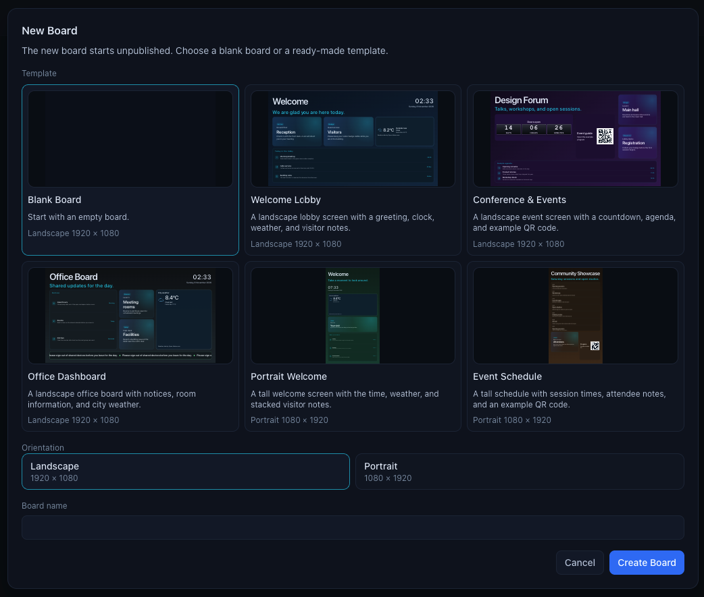

*Choose a template or a blank landscape or portrait board.*

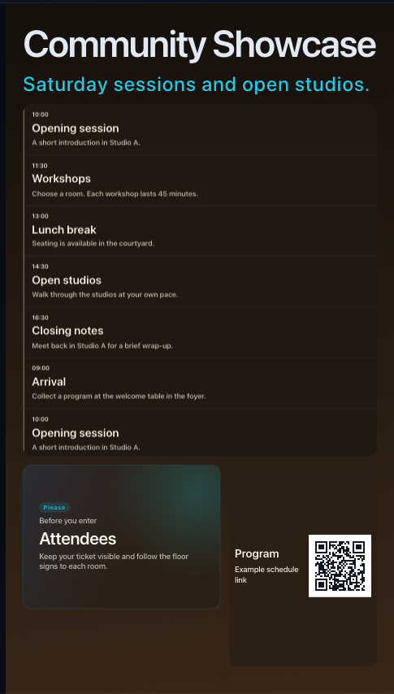

*Event Schedule in Preview, with a scrolling agenda and a program QR code.*

`/displays` lists screens, the assigned board, and whether a client is currently registered as that screen. A display can be renamed, assigned to a board, or left unassigned.

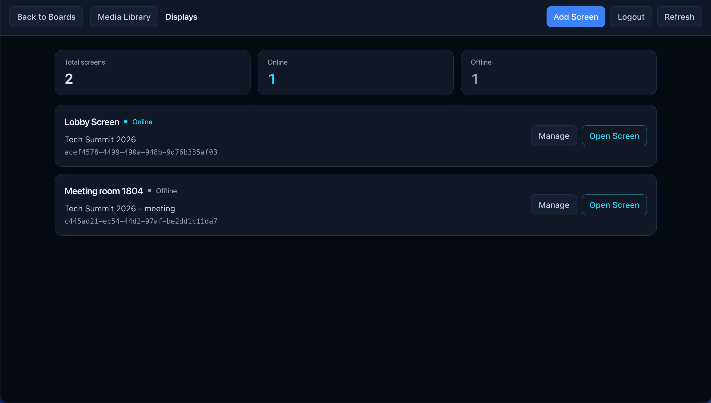

## Media library

`/media` is the administrator media library. Upload accepts one JPEG, PNG, or WebP image. The server decodes the file, rejects animated or oversized images, re-encodes it in the same format, and stores only those processed bytes. The library can filter by filename and sort by date or name.

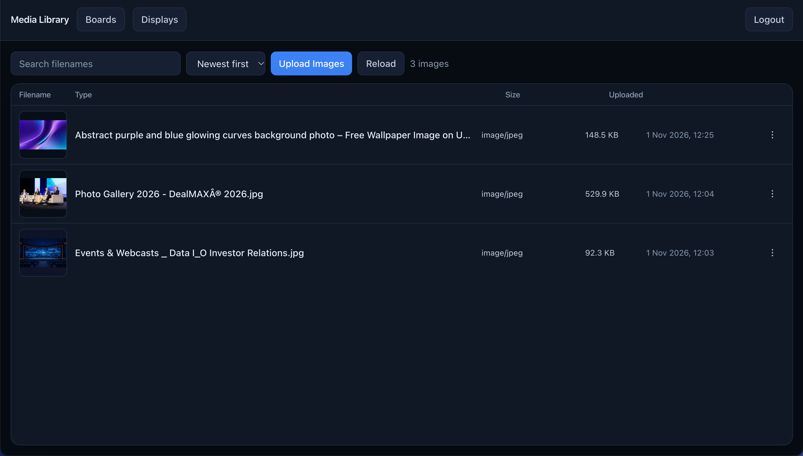

Image bytes live on disk. PostgreSQL stores metadata in `media_assets`. In local development the default directory is `server/storage/media`, which Git ignores. In Docker the API uses `MEDIA_DIR=/app/storage/media`. Asset references in a board use `/api/media/:id/file`. The static Tech Summit sample images under `client/public/media/tech-summit/` are separate files built into the web image.

## Public displays

These screenshots show the running application, using the same renderer as Studio Preview. The lobby and meeting room concept mockups in the use cases illustrate possible installations.

A direct display shows the published snapshot for one board:

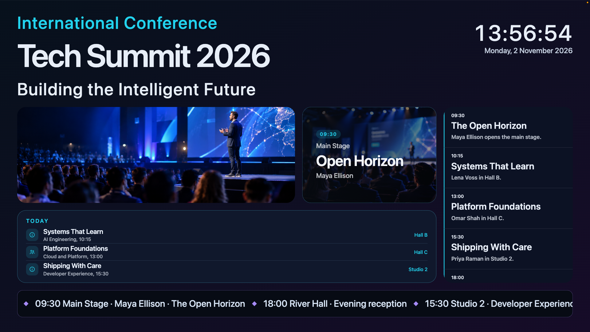

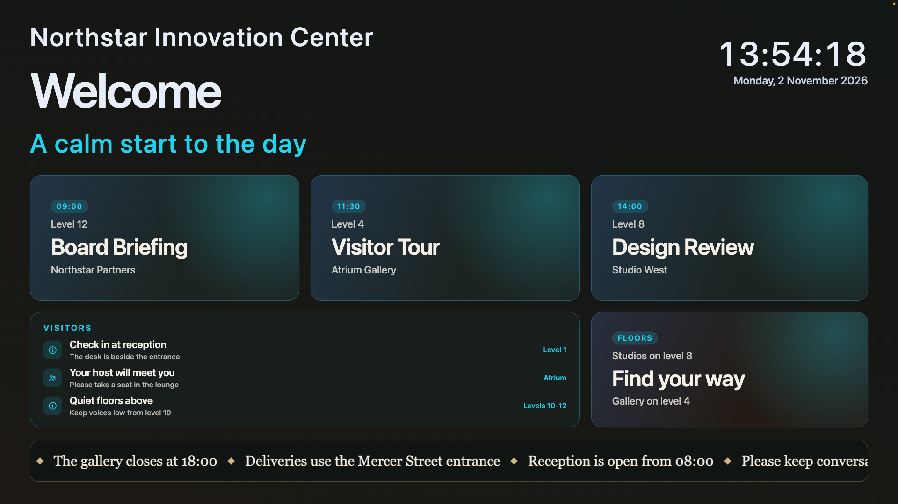

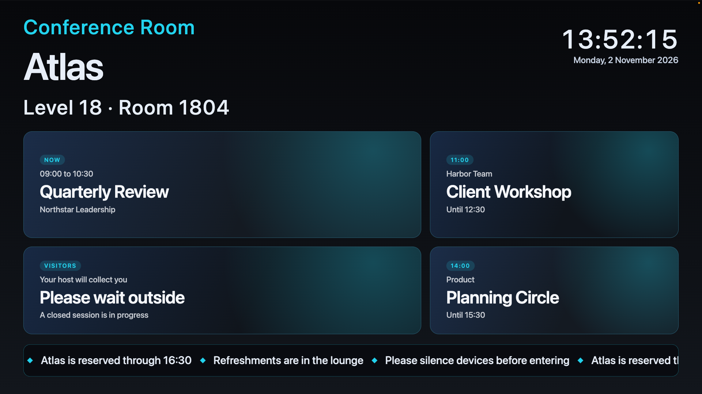

`/screens/:displayId` resolves the display, then shows its assigned board. If no board is assigned, the screen says so instead of showing an empty board. Draft edits do not change these pages. After a successful publish, Socket.IO notifies connected displays and they reload the published snapshot. A small banner appears if the realtime connection drops, and it hides again when the connection returns.

## Technology

| Area | Choice |
| --- | --- |
| Interface | React 19, TypeScript, Vite, React Router 7 |
| Styling | Tailwind CSS for the Studio shell, CSS Modules for board widgets |
| HTTP client | Axios |
| API | Node.js 22, Express 5, CommonJS |
| Database | PostgreSQL 18.6, accessed with `pg` and parameterized SQL |
| Realtime | Socket.IO 4 |
| Images | Sharp for decode and re-encode, Multer for the upload envelope |
| Production web | Nginx serving the built client and proxying `/api` and `/socket.io` |
| Containers | Docker Compose |

The client keeps editor and session state in React. It does not use Redux. The API does not use an ORM.

## Architecture

The repository has two packages, `client/` and `server/`. There is no root package.

```text
Browser
  Studio, boards, displays, and media require an administrator session
  /display/:boardId and /screens/:displayId are public

Nginx (Docker web image)
  Serves the built React app
  Proxies /api and /socket.io to the API on the Compose network

Express API
  Route, then validation and authentication, then controller, service, and repository

PostgreSQL
  Boards, displays, media metadata, the administrator account, and sessions
```

A publish writes the snapshot first and then emits the Socket.IO update. Studio preview, the public display, and the assigned screen all render through the same board components.

## Fresh Docker installation

Start Docker and run the commands below from the root of a Git clone. The first run creates dedicated database and media volumes. If the fresh volumes already exist on your machine, Compose will reuse their data even from a new clone. To test an empty installation alongside an existing one, use a separate Compose project and unique names for both volumes, the network, and the web and API images. Choose a free web port. Keep the existing volumes in place.

The Compose project name is `liveboard-studio-fresh`. Its database volume is `liveboard-studio-fresh_db`, mounted at `/var/lib/postgresql`. Its media volume is `liveboard-studio-fresh_media`, mounted at `/app/storage/media`. Web is published on `127.0.0.1` only. The API and PostgreSQL stay on the `liveboard-studio-fresh` network. Images are tagged `liveboard-studio-web:fresh` and `liveboard-studio-api:fresh`.

Copy `compose.fresh.env.example` to `.env.fresh`, choose a new database password, and run `chmod 600 .env.fresh`. `.env.fresh` is ignored by Git. Do not commit it, and do not put the administrator password in it. Every command below passes `--env-file .env.fresh` so Compose does not interpolate a different `.env` from the repository root.

`CLIENT_URL` must be the exact origin opened in the browser, including the port. Use `http://127.0.0.1` rather than `http://localhost`. If port 8080 is already taken, change `WEB_PORT` and `CLIENT_URL` together. `COOKIE_SECURE=false` is only for this loopback HTTP setup. This configuration is not for direct internet exposure. HTTPS hosting is not set up. A later HTTPS site would need `COOKIE_SECURE=true`, the exact `https` origin, and a separate decision to publish the web port beyond loopback.

PostgreSQL applies `POSTGRES_DB`, `POSTGRES_USER`, and `POSTGRES_PASSWORD` only while `liveboard-studio-fresh_db` is empty. Changing them later does not rewrite an initialized cluster.

Build the images:

```bash
docker compose --env-file .env.fresh -f compose.fresh.yaml build
```

Start only PostgreSQL and wait until `liveboard-studio-fresh-db-1` is healthy:

```bash
docker compose --env-file .env.fresh -f compose.fresh.yaml up -d --wait db
```

Apply migrations once. This creates the schema. It does not insert boards, displays, media, or an administrator:

```bash
docker compose --env-file .env.fresh -f compose.fresh.yaml run --rm --no-deps --entrypoint node api src/db/migrate.js
```

Create the single administrator. The password must be 12 to 128 characters and must not contain a null character. The username must be 1 to 64 characters without control characters. The command stores a scrypt hash and refuses to run when an account already exists. There is no public registration route.

```bash
printf 'Username: '
read -r ADMIN_USERNAME
printf 'Password: '
read -rs ADMIN_PASSWORD
printf '\n'
export ADMIN_USERNAME ADMIN_PASSWORD
docker compose --env-file .env.fresh -f compose.fresh.yaml run --rm --no-deps \
    -e ADMIN_USERNAME \
    -e ADMIN_PASSWORD \
    --entrypoint node api src/db/bootstrapAdmin.js
unset ADMIN_PASSWORD
```

Start the web and API containers:

```bash
docker compose --env-file .env.fresh -f compose.fresh.yaml up -d --no-build --wait
```

Open `http://127.0.0.1:8080` when `WEB_PORT` is 8080, or the origin stored in `CLIENT_URL`. Sign in with the account just created. On an empty installation, the board list starts empty. To verify the setup, create a board from Event Schedule, edit its title, and confirm the saved title survives a reload and appears in Preview. Publish the board and open its Display link in a private window. Save another title change and confirm the display keeps the published title until the next Publish.

### Optional Tech Summit Showcase

After completing the fresh Docker installation, run this command from the repository root to create the demo board shown at the top of this README.

```bash
docker compose --env-file .env.fresh -f compose.fresh.yaml run --rm --no-deps --entrypoint node api src/db/seed.js --showcase
```

Open **Tech Summit Showcase** from the boards list, click **Publish**, and open its **Display** link. The command creates an editable draft with a countdown set one week ahead. Running it again leaves the existing board intact. The background and images are bundled with the web image.

Run the same command without `--showcase` to create the original **Tech Summit 2026** sample.

Stop the fresh stack with `stop`. The named volumes remain, and the next start does not need another migration or bootstrap:

```bash
docker compose --env-file .env.fresh -f compose.fresh.yaml stop
docker compose --env-file .env.fresh -f compose.fresh.yaml up -d --no-build
```

Update the application by building again and starting the same project. Compose may recreate the fresh containers, but the named volumes keep the database and uploaded files. Do not add `-v`.

```bash
docker compose --env-file .env.fresh -f compose.fresh.yaml build
docker compose --env-file .env.fresh -f compose.fresh.yaml up -d
```

`docker compose down` without `-v` removes the fresh containers and keeps the volumes. `docker compose down -v` deletes `liveboard-studio-fresh_db` and `liveboard-studio-fresh_media`. Do not use `-v` unless that fresh installation should be erased. Never run a removal command against `compose.prod.yaml` or `compose.yaml` from these steps.

## Administrator bootstrap

There is one administrator account. Bootstrap stores a scrypt password hash and will not create a second account. There is no registration page.

For the Docker installation, use the one-shot command in [Fresh Docker installation](#fresh-docker-installation). Pass the username and password only as environment variables for that command, then unset `ADMIN_PASSWORD`.

For local development, from `server/`, set `ADMIN_USERNAME` and `ADMIN_PASSWORD` in the environment and run:

```bash
npm run admin:bootstrap
```

Unset `ADMIN_PASSWORD` afterward. Do not commit the password, and do not put it in `.env.fresh`.

## Local development

Local development uses the Vite client and a Node API on the host. Node.js 22 or newer is required. `compose.yaml` starts PostgreSQL only. It publishes PostgreSQL on `127.0.0.1` at `POSTGRES_PORT`, which defaults to 5433.

Copy the examples and replace the database password. Do not commit the copied env files.

```bash
cp .env.example .env
cp server/.env.example server/.env
cp client/.env.example client/.env
```

`server/.env.example` expects `DB_HOST=localhost`, `DB_PORT=5433`, and `CLIENT_URL=http://localhost:5173`. `client/.env.example` sets `VITE_API_BASE_URL=http://localhost:4002`. Open the client at that same `CLIENT_URL`. A different host, such as `127.0.0.1` when the setting says `localhost`, will not match the origin check.

Start PostgreSQL:

```bash
docker compose --env-file .env -f compose.yaml up -d
```

Do not start `compose.prod.yaml` while this development database container is running. Do not run `docker compose down -v`.

Install and prepare the API from `server/`:

```bash
npm install
npm run db:migrate
npm run dev
```

The API listens on port 4002. `npm start` runs the same server without nodemon. Create the administrator with `npm run admin:bootstrap` before signing in. For a local demo draft, run `npm run db:seed -- --showcase`. Run `npm run db:seed` for the original sample.

Install and start the client from `client/`:

```bash
npm install
npm run dev
```

Vite uses port 5173. `npm run lint` runs ESLint. `npm run build` typechecks and builds the client. `npm run preview` serves that build, but it does not proxy the API.

## Authentication and security

Login uses `POST /api/auth/login`. The session cookie is `liveboard.sid`. It is HttpOnly, `SameSite=Lax`, and lasts 7 days. PostgreSQL stores only the SHA-256 hash of the session token. A normal API restart keeps the session until it expires or the administrator signs out.

`COOKIE_SECURE` defaults to true when `NODE_ENV=production`. Leave it false only for local HTTP. Keep the admin interface and API on the same site so the browser sends the cookie.

State-changing requests must send `X-LiveBoard-Request: 1`. A browser `Origin` other than `CLIENT_URL` is rejected. Missing `Origin` is allowed for non-browser clients.

`/boards`, `/displays`, `/media`, and `/studio/:boardId` require the session. `/login` collects the username and password. `/display/:boardId` and `/screens/:displayId` stay public.

`GET /api/boards/:id/published` is public and returns the published snapshot, or `published: null` when the board exists but has not been published. It does not return the draft. `GET /api/displays/:id` is public so a screen can resolve its assignment. It returns the display id, name, and assigned board id.

`GET /api/media` and `GET /api/media/:id` require an administrator session. `GET /api/media/:id/file` stays public so a published display can load an image whose file URL is already stored in the board. `POST /api/media` accepts one image from an administrator and requires the CSRF header.

Failed logins are limited to 10 attempts per address and username in a 15 minute window. The counter is stored in API memory, so a restart clears it.

Any client that knows a display UUID can register as that screen and appear online. That presence check is not device authentication, and it does not allow board or display edits.

## Known limitations

- One administrator. No organizations, roles, or public registration.
- Board and display deletion are unavailable. Media assets can be deleted when no saved board references them.
- No device pairing. Knowing a display id is enough to appear online.
- Weather uses Open-Meteo. The live news source is the USGS earthquake feed. General headlines use sample content, and schedules are entered on the board.
- No production HTTPS deployment. The current Compose files bind web to loopback HTTP.
- Login throttling is per process and uses the connecting IP. The API does not enable `trust proxy`.
- A storage quota is not enforced. A crash after the file is written and before the metadata insert can leave an unreferenced file. A failed insert removes the file it just wrote.
- Replacing an uploaded image under the same id is not implemented. Existing boards keep the file URL they stored.
- This repository does not document a customer deployment. The mockups are design concepts.

## Existing local data

`compose.prod.yaml` is a separate localhost profile for volumes that already exist. It also publishes web only on `127.0.0.1`. Do not start it while the development database container from `compose.yaml` is running. Do not run `docker compose down -v` against it. Do not point `compose.fresh.yaml` at its volumes.

For that profile, the API mounts the external media volume at `/app/storage/media`. Apply migrations once with `node src/db/migrate.js` after that database is the only PostgreSQL process attached to its volume. Do not run migrations on API startup. Do not run `src/db/seed.js` or `src/db/bootstrapAdmin.js` against that database.

Before copying media or attaching an existing database volume, back up that volume and keep the backup outside the Git repository. To copy host files into the media volume, use a one-off container. Mount the host directory read-only and the named media volume read-write. Override the image entrypoint so PostgreSQL does not start, and do not mount the database volume. Copy a file only when that filename is absent. If it is present and the checksum differs, stop. Do not overwrite a destination file with different bytes. After a matching copy, change ownership to uid 1000 and gid 1000. Leave the host files in place.
